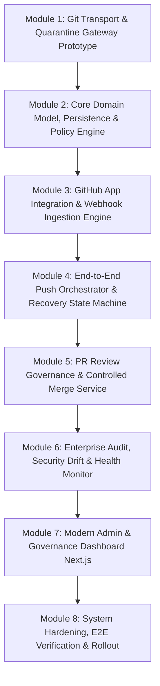

# Sordian: Engineering Implementation Plan & Architecture Specification

> **Status:** Architecture & Phased Implementation Blueprint (Gravitas-Grounded)  
> **Source Documents:** [`Sordian_PRD.md`](file:///home/rachit/Documents/Code/Infornics/Marketplace/Sordian/docs/Sordian_PRD.md), [`Tech_Stack.md`](file:///home/rachit/Documents/Code/Infornics/Marketplace/Sordian/docs/Tech_Stack.md)  
> **Target Topology:** Monorepo (Next.js 15+ Frontend + Java 21 / Spring Boot 3.3+ Modular Monolith + PostgreSQL 16)  

---

## 1. Executive Summary & Product Thesis

**Sordian** is an enterprise-grade Git write-path governance gateway and PR policy coordinator for GitHub organizations. It acts as an authoritative proxy between local developer clients and canonical GitHub repositories to enforce branch protection, history-rewrite bans, and pull request approval workflows without requiring GitHub Enterprise license tiers.

```
+------------------+         Git Push (Smart HTTP)        +----------------------------------------+
| Developer Client | -----------------------------------> | Sordian Gateway (Java 21 / Spring Boot)|
+------------------+                                      +----------------------------------------+
         |                                                                    |
         | Fetch / Clone                                                      | 1. Quarantine & Parse
         v                                                                    | 2. Policy Engine Evaluation
+-------------------+                                                         | 3. Upstream Forwarding
| GitHub Canonical  | <-------------------------------------------------------+
|  (Source of Truth)|                Git Push over HTTPS (GitHub App Token)
+-------------------+
```

### Core Invariants
1. **GitHub is the Sole Canonical Truth:** Sordian never acts as a permanent secondary Git mirror. It stores policy metadata, audit trails, and transactional push-attempt states.
2. **Quarantine Before Publication:** Git push packfiles land in isolated, short-lived quarantine workspaces. No branch ref on canonical GitHub is modified until the policy engine yields a definitive `PASS`.
3. **No Phantom Success:** The developer's `git push` returns exit code `0` **only** after GitHub's upstream confirms that the ref update was successfully applied.
4. **Fail-Closed Governance:** If Sordian, its database, or the policy engine is unavailable, writes fail. Sordian never fails open.

---

## 2. Recommended Industry-Grade Monorepo Directory Structure

To maximize developer velocity, enforce modular decoupling, and enable shared contract testing, the repository is structured as an industry-grade modular monorepo:

```text
/home/rachit/Documents/Code/Infornics/Marketplace/Sordian/
├── .github/
│   ├── workflows/
│   │   ├── ci-backend.yml            # Java build, Checkstyle, Unit & Integration tests
│   │   ├── ci-frontend.yml           # ESLint, TypeScript typecheck, Next.js build
│   │   ├── e2e-git-gateway.yml       # Disposable Docker Git-push integration suite
│   │   └── security-scan.yml         # Trivy container & dependency vulnerability scan
│   └── CODEOWNERS
├── apps/
│   └── web/                          # Next.js 15 Frontend (App Router)
│       ├── public/
│       ├── src/
│       │   ├── app/                  # App router routes & layout
│       │   │   ├── (auth)/login/
│       │   │   ├── (dashboard)/
│       │   │   │   ├── overview/
│       │   │   │   ├── repositories/
│       │   │   │   │   └── [id]/policies/
│       │   │   │   ├── pull-requests/
│       │   │   │   ├── audit-log/
│       │   │   │   └── settings/integrations/
│       │   │   │   └── layout.tsx
│       │   │   ├── api/auth/         # NextAuth / OAuth session handlers
│       │   │   └── layout.tsx
│       │   ├── components/
│       │   │   ├── ui/               # shadcn/ui primitive library (Button, Dialog, etc.)
│       │   │   ├── policies/         # Pattern editors, approval sliders, rule toggles
│       │   │   ├── audit/            # Filtering tables, status badges, diff previews
│       │   │   └── common/           # Navigation, header, breadcrumbs, theme-provider
│       │   ├── hooks/                # React query / SWR data fetching hooks
│       │   ├── lib/                  # Fetch client, OpenAPI generated types, utils
│       │   └── types/                # Frontend DTO contracts
│       ├── Dockerfile
│       ├── package.json
│       ├── tailwind.config.ts
│       └── tsconfig.json
├── backend/                          # Java 21 / Spring Boot 3.3+ Modular Backend
│   ├── gradle/
│   │   └── wrapper/
│   ├── src/
│   │   ├── main/
│   │   │   ├── java/com/infornics/sordian/
│   │   │   │   ├── SordianApplication.java
│   │   │   │   ├── config/           # SecurityConfig, GitGatewayConfig, AsyncConfig
│   │   │   │   ├── core/             # Cross-cutting primitives (Result, DomainEvents, CorrelationId)
│   │   │   │   ├── modules/
│   │   │   │   │   ├── auth/         # JWT, GitHub OAuth, API Key verification
│   │   │   │   │   ├── organization/ # Organization & workspace aggregate, members
│   │   │   │   │   ├── repository/   # Repository registry, GitHub App enrollment, status
│   │   │   │   │   ├── policy/       # Policy aggregate, protected patterns, rule evaluators
│   │   │   │   │   ├── git/          # HIGH-RISK: Smart HTTP transport, quarantine, CLI runner
│   │   │   │   │   │   ├── transport/  # GitSmartHttpFilter, UploadPack/ReceivePack controllers
│   │   │   │   │   │   ├── quarantine/ # QuarantineStorageManager, TempDirectoryLifecycle
│   │   │   │   │   │   ├── inspection/ # PreReceiveHookExecutor, RefUpdateParser, CommitInspector
│   │   │   │   │   │   ├── forward/    # UpstreamForwarder, GitHubTokenBroker
│   │   │   │   │   │   └── state/      # PushAttemptStateMachine (PostgreSQL backed)
│   │   │   │   │   ├── github/       # GitHub App client, JWT signing, installation tokens
│   │   │   │   │   ├── webhook/      # Signature validation, event deduplication, dispatch
│   │   │   │   │   ├── pullrequest/  # PR snapshots, review evaluation, check suite gates
│   │   │   │   │   ├── merge/        # Merge orchestrator, revalidation, merge commit executor
│   │   │   │   │   └── audit/        # Append-only audit logger, filterable queries
│   │   │   └── resources/
│   │   │       ├── application.yml
│   │   │       ├── application-dev.yml
│   │   │       ├── application-prod.yml
│   │   │       └── db/migration/     # Flyway SQL migrations (V1__init.sql, V2__...)
│   │   └── test/
│   │       ├── java/com/infornics/sordian/
│   │       │   ├── unit/             # Isolated unit tests (JUnit 5 + Mockito)
│   │       │   ├── integration/      # Spring Boot slice & Testcontainers tests
│   │       │   └── git/              # Subprocess Git CLI execution & quarantine test suite
│   │       └── resources/
│   │           └── application-test.yml
│   ├── build.gradle
│   ├── settings.gradle
│   └── Dockerfile
├── deploy/
│   ├── docker-compose.yml            # Local dev stack (PostgreSQL + Sordian + WireMock)
│   ├── docker-compose.prod.yml       # Production deployment definition
│   └── postgres/
│       └── init.sql                  # Initial DB configurations and extensions
├── docs/                             # Engineering specs & architecture decisions
│   ├── Sordian_PRD.md
│   ├── Tech_Stack.md
│   └── architecture/
│       ├── git-quarantine-lifecycle.md
│       ├── failure-recovery-matrix.md
│       └── openapi.yaml
└── .gitignore
```

---

## 3. Recommended Industry-Grade Package & Dependency Selections

### 3.1 Backend Dependencies (`build.gradle`)
* **Java Runtime:** Eclipse Temurin Java 21 LTS (`languageVersion = JavaLanguageVersion.of(21)`).
* **Framework:** Spring Boot `3.3.x` (LTS baseline with robust Spring Security 6 & Hibernate 6).
* **Database & Persistence:**
  * `org.postgresql:postgresql:42.7.+`
  * `org.springframework.boot:spring-boot-starter-data-jpa`
  * `org.flywaydb:flyway-core` & `org.flywaydb:flyway-database-postgresql` (Strict versioned schema migrations).
* **Git Handling:**
  * Subprocess management via `java.lang.ProcessBuilder` executing standard Linux `git` CLI (minimum 2.43+), providing strict process sandboxing, argument escaping, and memory isolation without buggy in-memory packfile parsers.
  * `org.eclipse.jgit:org.eclipse.jgit:6.9.+` (Used selectively for read-only Git object inspection / tree walks in-memory when quarantine repo is opened).
* **GitHub Integration & Security:**
  * `io.jsonwebtoken:jjwt-api:0.12.+`, `jjwt-impl`, `jjwt-jackson` (GitHub App RS256 JWT generation).
  * `org.kohsuke:github-api:1.324` or raw `WebClient` / `RestClient` for targeted, resilient GitHub REST invocations.
  * `commons-codec:commons-codec` (HMAC SHA-256 webhook signature validation).
* **Resilience & Concurrency:**
  * `io.github.resilience4j:resilience4j-spring-boot3:2.2.0` (Circuit breakers, retries, and rate limiters for GitHub upstream calls).
* **Testing:**
  * `org.testcontainers:postgresql:1.20.+` (Realistic disposable PostgreSQL in CI/CD).
  * `org.wiremock:wiremock-standalone:3.9.+` (Simulating GitHub API rate limits, timeouts, and webhook payloads).
  * `io.rest-assured:rest-assured:5.4.+` (REST endpoint acceptance testing).

### 3.2 Frontend Dependencies (`package.json`)
* **Framework:** Next.js `15.x` (App Router) + React `19.x` + TypeScript `5.6+`.
* **Styling & UI Components:**
  * Tailwind CSS `v3.4+` or `v4.0`
  * `shadcn/ui` (Radix UI primitives under the hood)
  * `lucide-react` (Crisp, modern iconography)
* **Form & Validation:**
  * `react-hook-form` + `@hookform/resolvers` + `zod` (For policy configuration forms and pattern testing).
* **Data Fetching & State:**
  * `@tanstack/react-query:v5` (SWR caching, background revalidation for push attempts and audit logs).
* **Testing:**
  * `@playwright/test:1.48+` (End-to-end browser tests for policy flows and auth).

---

## 4. Module-by-Module Step-by-Step Implementation Plan

To guarantee system stability, implementation follows a strict **inside-out risk order**. The highest-risk component—the Git Push Quarantine and Smart HTTP Gateway—is proven first before building surrounding management interfaces.



---

### Module 1: Git Smart HTTP Transport & Quarantine Gateway Prototype
*Objective: Build the isolated Git push receiver that intercepts packfiles, inspects ref updates, enforces fast-forward semantics, and forwards to GitHub without any web dashboard dependency.*

- **Step 1.1: Git Smart HTTP Protocol Handler**
  - Implement Spring MVC Controller mapping `/{org}/{repo}.git/info/refs?service=git-receive-pack` and `/{org}/{repo}.git/git-receive-pack`.
  - Handle Git authentication challenge (HTTP 401 Basic Auth with personal access tokens or dedicated Sordian CLI tokens).
  - Stream `git-receive-pack` request body directly to a subprocess `git-receive-pack --stateless-rpc <quarantine-repo-path>` with `GIT_OBJECT_DIRECTORY_QUARANTINE` configured.
- **Step 1.2: Quarantine Workspace Lifecycle Manager**
  - Allocate a unique directory per push transaction in `/tmp/sordian-quarantine/<push-id>` or dedicated NVMe scratch mount.
  - Set strict POSIX permissions (`0700`), process execution timeouts, and disk quotas.
- **Step 1.3: Reference Update Parser & Inspect Hooks**
  - Intercept the incoming ref commands in format: `<old-oid> <new-oid> <ref-name>`.
  - Check non-fast-forward status: execute `git merge-base --is-ancestor <old-oid> <new-oid>`. If exit code != 0, tag as `REJECTED_NON_FAST_FORWARD`.
  - Check branch deletion: if `<new-oid>` is `0000000000000000000000000000000000000000`, tag as `REJECTED_BRANCH_DELETION`.
- **Step 1.4: Direct Forwarding Proof-of-Concept [COMPLETED]**
  - For permitted ref updates, push quarantine objects to an upstream test GitHub repository using a mock or configured GitHub token.
  - Return HTTP 200 with standard Git receive-pack status packet (`unpack ok\nok <ref>`) only after GitHub confirms.
  - Execute post-push cleanup removing quarantine directories on exit.
- **Verification Gate (Gravitas) [COMPLETED]:**
  - Integration test running actual local Git push protocol requests against `localhost:8080/acme/core-api.git`.
  - Assert that fast-forward commits succeed upstream with `ok refs/heads/<branch>`.
  - Assert that branch deletions and force pushes are rejected with:
    `remote: [SORDIAN REJECTED] ...`

---

### Module 2: Core Domain Model, Persistence & Policy Engine
*Objective: Establish Flyway-migrated PostgreSQL schema and pure deterministic policy evaluation logic.*

- **Step 2.1: PostgreSQL Schema & Flyway Migrations**
  - Create table `organizations` (id, slug, github_installation_id, created_at).
  - Create table `repositories` (id, org_id, github_repo_id, name, default_branch, is_active).
  - Create table `repository_policies` (id, repo_id, version, protected_branch_patterns, min_approvals, allow_author_approval, created_at, created_by).
  - Create table `push_attempts` (id, repo_id, pusher_id, ref_name, old_oid, new_oid, status, rejection_reason, duration_ms, created_at).
- **Step 2.2: Pure Deterministic Policy Evaluator**
  - Implement `PolicyEngine` component:
    - `PolicyDecision evaluatePush(RepositoryPolicy policy, RefUpdateRequest request)`
    - Pattern matching against protected branch globs (e.g., `main`, `master`, `release/*`).
    - If ref matches protected branch: Reject direct push (`Direct pushes to protected branches are forbidden. Please submit a Pull Request.`).
- **Step 2.3: Multi-Ref Atomic Push Handler**
  - Enforce PRD FR-18: If a client pushes multiple refs in a single transaction (e.g. `git push origin branch1 branch2`), all refs must be evaluated. If any ref fails policy, the entire transaction is aborted before any ref is forwarded.
- **Verification Gate (Gravitas):**
  - Unit test suite testing 30+ pattern matching combinations (glob patterns, branch creation, tag pushes, delete attempts).
  - Database schema integration tests with Testcontainers verifying constraints, indexes, and foreign keys.

---

### Module 3: GitHub App Integration & Webhook Ingestion Engine
*Objective: Authenticate as a GitHub App, handle token generation, and reliably process webhooks with signature checks and deduplication.*

- **Step 3.1: GitHub App Authentication & Installation Token Broker**
  - Generate RS256 JWTs signed with the GitHub App private key (PKCS#8).
  - Cache short-lived installation access tokens in memory, refreshing 5 minutes before expiration.
- **Step 3.2: Secure Webhook Receiver**
  - Implement `/api/v1/webhooks/github` endpoint.
  - Verify `X-Hub-Signature-256` header using HMAC SHA-256 against configured webhook secret. Drop and log invalid signatures immediately.
- **Step 3.3: Idempotent Webhook Dispatcher**
  - Record incoming `X-GitHub-Delivery` GUID in `webhook_deliveries` table.
  - Ignore duplicate deliveries with HTTP 200 acknowledgment.
  - Handle core events:
    - `installation`: Track repo additions/removals.
    - `pull_request`: Invalidate approval caches on PR synchronize (`push` to PR head).
    - `pull_request_review`: Track review submissions and dismissals.
- **Verification Gate (Gravitas):**
  - WireMock integration tests: simulate GitHub App token endpoint with expiration.
  - WireMock webhook tests: simulate out-of-order and duplicate webhook payloads; verify idempotency.

---

### Module 4: End-to-End Push Orchestrator & Durable Recovery State Machine
*Objective: Wire the Git transport to the database state machine and handle timeouts, network partitions, and upstream reconciliation.*

- **Step 4.1: Durable State Machine Implementation**
  - Implement state lifecycle: `RECEIVED` -> `VALIDATING` -> `REJECTED` or `FORWARDING` -> `CONFIRMED` / `OUTCOME_UNKNOWN`.
  - Save ref update state to PostgreSQL before initiating upstream push.
- **Step 4.2: Upstream Forwarding Worker**
  - Execute upstream push over authenticated HTTPS directly to GitHub API/Git endpoint using short-lived App installation token.
  - Enforce client timeout bounds (e.g., maximum 30 seconds for validation + forwarding).
- **Step 4.3: Failure & Ambiguous Outcome Reconciler**
  - If upstream push times out or connection drops mid-flight:
    - Mark status `OUTCOME_UNKNOWN`.
    - Trigger immediate query to GitHub ref API: `GET /repos/{owner}/{repo}/git/ref/heads/{branch}`.
    - If upstream SHA equals `<new-oid>`, transition state to `CONFIRMED`.
    - If upstream SHA does not equal `<new-oid>`, mark as `FAILED_RETRYABLE` and instruct developer to retry.
- **Step 4.4: Concurrency Lock Manager**
  - Use database row-level locking (`SELECT ... FOR UPDATE` on repository ref) or distributed lock to prevent race conditions during concurrent pushes to the same branch.
- **Verification Gate (Gravitas):**
  - Simulate network drop using Toxiproxy/WireMock during upstream forwarding; assert that reconciler detects actual GitHub state and resolves `OUTCOME_UNKNOWN`.

---

### Module 5: Pull Request Review Governance & Controlled Merge Service
*Objective: Enforce approval counts, author exclusion, freshness checks, and coordinate controlled merge execution.*

- **Step 5.1: PR Eligibility Evaluation Engine**
  - Fetch PR reviews via GitHub REST API.
  - Filter reviews:
    - Exclude PR author's approval (FR-08).
    - Only consider the latest review state per user (`APPROVED`, `CHANGES_REQUESTED`, `DISMISSED`).
    - Exclude stale reviews: if review commit SHA does not match PR head commit SHA, mark approval as stale.
  - Evaluate total valid approvals against `min_approvals`.
- **Step 5.2: Pre-Merge Double Check (Anti-TOCTOU)**
  - Prior to issuing the merge API call, re-query the PR head SHA from GitHub.
  - If any new commit was pushed between check and merge, abort merge and flag re-evaluation.
- **Step 5.3: Authorized Merge Executor**
  - Perform merge via GitHub API (`PUT /repos/{owner}/{repo}/pulls/{pull_number}/merge`) using Sordian's service identity.
  - Log merge commit SHA and record audit entry.
- **Verification Gate (Gravitas):**
  - Test matrix: author approves own PR (fails); stale approval after commit push (fails); valid approvals from 2 peers (passes).

---

### Module 6: Enterprise Audit, Security Drift & Health Monitor
*Objective: Build immutable audit logs, administrative alerting, and configuration drift detection.*

- **Step 6.1: Append-Only Audit Event Bus**
  - Create table `audit_events` (id, correlation_id, actor, event_type, repository_id, payload, ip_address, created_at).
  - Mask all secrets, private keys, and authorization headers before persistence.
- **Step 6.2: Permission Drift Detection Job**
  - Run scheduled job (every 15-30 minutes) checking GitHub repository collaborator permissions.
  - Detect if any developer identity has been granted direct GitHub write/admin access bypassing Sordian.
  - Trigger alert flags on dashboard if drift is detected.
- **Step 6.3: Quota & Garbage Collection Sweeper**
  - Scheduled background sweeper deleting any temporary quarantine files older than 1 hour.
  - Log storage metrics and warn if quarantine disk exceeds 80% capacity.
- **Verification Gate (Gravitas):**
  - Unit tests verifying secret scrubbing in audit payloads.
  - Test drift detector by mocking GitHub collaborator API returning `permission: admin`.

---

### Module 7: Next.js Modern Admin & Governance Dashboard
*Objective: Build a high-aesthetic, responsive, real-time dashboard for administrators and developers.*

- **Step 7.1: Design System & Shared Layout**
  - Setup Tailwind CSS + `shadcn/ui` with dark mode support and curated palette.
  - Build navigation shell: Installation selector, repository sidebar, system health indicators.
- **Step 7.2: Repository & Write-Path Setup Wizard**
  - List all enrolled repositories with clear Git remote instructions:
    ```bash
    # Direct fetch/clone to GitHub, push through Sordian:
    git remote set-url --push origin https://sordian.internal.org/git/acme-corp/core-api.git
    ```
- **Step 7.3: Visual Policy Editor**
  - Form with instant regex/glob validation for protected branches.
  - Sliders for minimum approvals; toggles for author approval and branch deletion bans.
- **Step 7.4: Real-Time Audit Log & Push Inspector**
  - Data table with filtering by actor, repository, decision (`ACCEPTED`, `REJECTED`, `RECONCILED`), and date.
  - Detailed modal showing correlation ID, ref changes (`old_oid` -> `new_oid`), and exact policy failure diagnostics.
- **Verification Gate (Gravitas):**
  - Playwright E2E test verifying policy update, repository status display, and audit log inspection.

---

### Module 8: System Hardening, E2E Verification & Rollout
*Objective: End-to-end rehearsal, performance baseline, and documented operational runbook.*

- **Step 8.1: End-to-End Rehearsal in Staging GitHub Organization**
  - Configure test organization with 2 private repos.
  - Execute end-to-end developer journey: clone, push feature branch, open PR, attempt bypass force-push, approve PR, merge through Sordian.
- **Step 8.2: Load & Latency Benchmarking**
  - Benchmark Git push latency overhead (target: < 350ms added latency for typical push payloads < 5MB).
- **Step 8.3: Disaster Recovery & Operational Runbook**
  - Document database backup/restore procedures.
  - Document emergency bypass protocol in the event of an extended gateway outage.
- **Verification Gate (Gravitas):**
  - Full execution of PRD Section 13 Acceptance Criteria (AC-01 through AC-15).

---

## 5. Next Immediate Step

As dictated by the risk-ordered engineering strategy, **Phase 1 begins with Backend Module 1 (Git Smart HTTP & Quarantine Gateway)**.

Would you like to proceed with:
1. Setting up the Gradle dependencies and directory structure for the Git transport module?
2. Creating the initial Flyway migration scripts and database entities?
3. Reviewing or refining any specific module in this blueprint?
