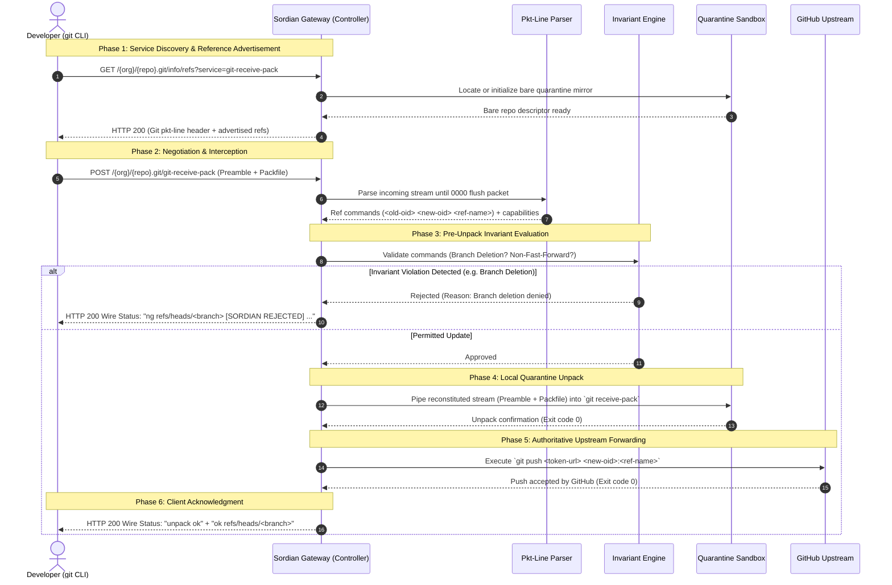

# 01: Architecture & Lifecycle

This document provides a conceptual and architectural overview of Sordian's Git gateway prototype, detailing the design philosophy, transaction lifecycle, and domain abstractions.

---

## 1. Design Philosophy

### 1.1 The Airport Quarantine Analogy
To understand Sordian's architecture without getting lost in Git internals, consider how international agricultural quarantine works at an international airport:

```
[ Traveler Cargo ] ────> [ Customs & Quarantine Gate ] ────> [ Domestic Mainland ]
       ^                             │                               │
(Raw Git Packfile)         1. Unpack into clean room         (Authoritative GitHub)
                           2. Inspect declaration
                           3. If invasive/illegal: REJECT
                           4. If cleared: FORWARD
```

1. **The Domestic Mainland is GitHub:** GitHub remains the sole, authoritative system of record. Sordian never aims to replace GitHub; it acts as its protective border control.
2. **The Cargo is a `git push` Payload:** A push contains a shipping manifest (the reference updates such as `refs/heads/main`) followed by a binary shipping container (the Git packfile containing commit, tree, and blob objects).
3. **The Customs Inspection is Sordian:** Sordian intercepts the shipment before it enters the mainland. The cargo is unsealed in a clean-room quarantine area on disk. 
4. **Enforcing Invariants:**
   - Did the traveler attempt to erase the mainland's trade history? (*Force push / non-fast-forward*).
   - Did the traveler attempt to eliminate a critical territory? (*Branch deletion*).
5. **The Clearance:** If and only if the cargo passes all safety checks, Sordian's automated transport delivers the cargo to GitHub and provides the traveler with an official stamp of approval (`unpack ok`).

---

## 2. The Complete Transaction Lifecycle

A Git push transaction is an interactive two-phase network conversation over HTTP. The diagram below illustrates each stage of this lifecycle:



---

## 3. High-Level Lifecycle Phases

### Phase 1: Reference Discovery Handshake
Before a developer's Git client can build a push payload, it must query the remote to determine what commit object IDs already exist. 
- The client initiates an HTTP GET request to `/{org}/{repo}.git/info/refs?service=git-receive-pack`.
- Sordian queries the local quarantine bare repository and transmits a formatted advertisement containing current references and supported server capabilities (`report-status`, `side-band-64k`).
- The developer's Git client computes the minimal delta between its local branches and the remote advertisement, creating an optimized zlib-compressed packfile.

### Phase 2: Stream Interception
- The developer's Git client sends an HTTP POST to `/{org}/{repo}.git/git-receive-pack`.
- The request body contains two segments:
  1. A text-based **Command Preamble** listing requested updates (e.g. update `refs/heads/main` from commit `A` to commit `B`).
  2. A raw binary **Packfile** containing the new commits, directory trees, and file blobs.
- Sordian intercepts this stream in-flight, reading the preamble without exhausting the remaining packfile data.

### Phase 3: Invariant Evaluation
- Before unpack or disk storage occurs, Sordian analyzes the proposed commands.
- If a command represents a branch deletion (`new-oid == 0000000000000000000000000000000000000000`) or a history overwrite (checked against the commit ancestry tree via `git merge-base`), Sordian halts the transaction immediately.
- A Git wire rejection message (`ng <ref> [SORDIAN REJECTED] ...`) is returned. Upstream GitHub is completely isolated from the attempt.

### Phase 4: Quarantine Ingestion
- For permitted updates, Sordian stitches the captured command preamble and the binary packfile stream back together into a single continuous stream (`SequenceInputStream`).
- The stream is fed into a sandboxed `git receive-pack --stateless-rpc` process running inside the local quarantine directory.
- This unpacks and verifies the cryptographic integrity (SHA-1 / SHA-256 object hashes) of all incoming objects.

### Phase 5: Upstream Forwarding
- Once unpacked locally, Sordian pushes the verified refspec (`<new-oid>:<ref-name>`) to the authoritative GitHub repository using machine token credentials (`https://x-access-token:<TOKEN>@github.com/...`).
- Only when GitHub responds with an exit code of `0` does Sordian confirm completion.

### Phase 6: Client Acknowledgment
- Sordian streams the final Git wire confirmation (`unpack ok` and `ok refs/heads/<branch>`) back to the developer's terminal.
- From the developer's point of view, standard tools like `git push` function smoothly with zero plugin or credential overhead.

---

## 4. Next Document
To understand the low-level wire formats, HTTP headers, pkt-line frames, and multiplexing protocols used during this lifecycle, see [02_Smart_HTTP_and_Wire_Protocol.md](./02_Smart_HTTP_and_Wire_Protocol.md).
