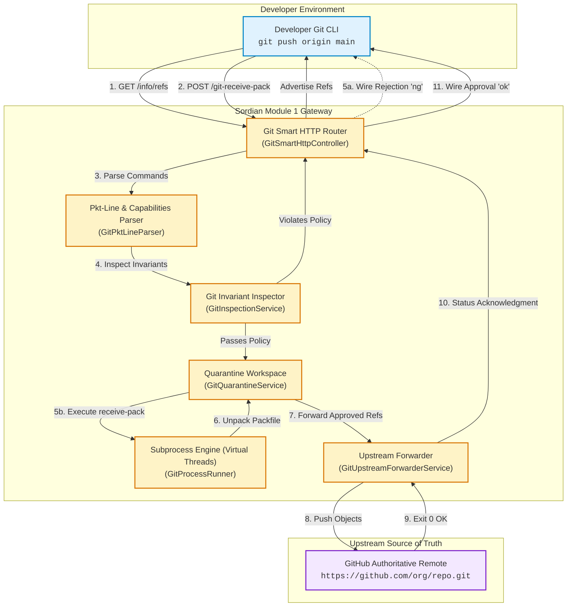

# Module 1: Git Smart HTTP Transport & Quarantine Gateway Prototype

Welcome to the documentation for **Module 1** of Sordian. This module forms the foundational network and storage tier of Sordian: an authoritative Git write-path governance proxy and push interceptor.

---

## 1. Executive Summary

In traditional software development environments, developers push code directly to remote Git hosts (such as GitHub, GitLab, or Bitbucket). Although these platforms provide branch protection rules, advanced governance capabilities—such as blocking unapproved merges across an entire organization, enforcing multi-party sign-offs, and preventing catastrophic force-pushes—frequently require premium enterprise licensing. Moreover, because remote webhooks run **after** a push has landed, traditional validation is asynchronous and reactive.

**Sordian transforms Git governance from reactive cleanup to proactive pre-flight interception.**

Operating as a transparent Git Smart HTTP gateway, Sordian stands between engineers and GitHub. It receives push transactions, isolates raw commit payloads in an ephemeral disk quarantine, verifies Git safety invariants and branch governance policies, and forwards approved commits directly to GitHub without requiring modifications to developers' standard Git CLI tools.

---

## 2. Documentation Architecture

To ensure clarity, accessibility, and deep technical rigor without needing to inspect the underlying source code, the documentation for this module is structured into specialized documents:

```
docs/modules/Module 1: Git Smart HTTP Transport & Quarantine Gateway Prototype/
├── 01_Architecture_and_Lifecycle.md       # High-level architecture, lifecycles, and core analogies
├── 02_Smart_HTTP_and_Wire_Protocol.md     # Git Smart HTTP RFC, pkt-line framing, and sideband-64k
├── 03_Quarantine_Storage_and_Subprocess.md # Ephemeral disk isolation and virtual-threaded Git CLI execution
├── 04_Inspection_and_Policy_Guards.md     # Reference parsing, branch deletion, and force-push prevention
├── 05_Upstream_Forwarding_Engine.md       # Token authentication, ref forwarding, and atomic status reporting
└── 06_Testing_and_Verification_Playbook.md# Automated test suites, CLI verification, and Postman API scenarios
```

---

## 3. High-Level Module Blueprint



---

## 4. Key Guarantees Provided by Module 1

| Feature | Description | Reference Document |
| :--- | :--- | :--- |
| **Write-Only Interception** | Sordian proxies only push transactions (`git-receive-pack`). Read operations (`git-upload-pack`) are safely rejected with HTTP 403 Forbidden to conserve resources. | [02: Smart HTTP & Wire Protocol](./02_Smart_HTTP_and_Wire_Protocol.md) |
| **Pkt-Line & Sideband Multiplexing** | Full RFC-compliant framing supporting `side-band-64k` channel multiplexing, avoiding client-side wire protocol parse failures. | [02: Smart HTTP & Wire Protocol](./02_Smart_HTTP_and_Wire_Protocol.md) |
| **Scratch Quarantine Isolation** | Pushed packfiles are unpacked into local bare mirrors before any upstream interaction, ensuring damaged or malicious objects never reach GitHub. | [03: Quarantine Storage & Subprocess](./03_Quarantine_Storage_and_Subprocess.md) |
| **Force-Push & Deletion Rejection** | Deterministic detection of branch deletions (`new-oid == 0000...`) and non-fast-forward history overwrites via ancestor graphing. | [04: Inspection & Policy Guards](./04_Inspection_and_Policy_Guards.md) |
| **Atomic Upstream Forwarding** | The client receives an `ok` receipt only after upstream GitHub validates and accepts the objects. | [05: Upstream Forwarding Engine](./05_Upstream_Forwarding_Engine.md) |

---

## 5. Next Steps
Begin exploring the system architecture and lifecycle by visiting [01_Architecture_and_Lifecycle.md](./01_Architecture_and_Lifecycle.md).
