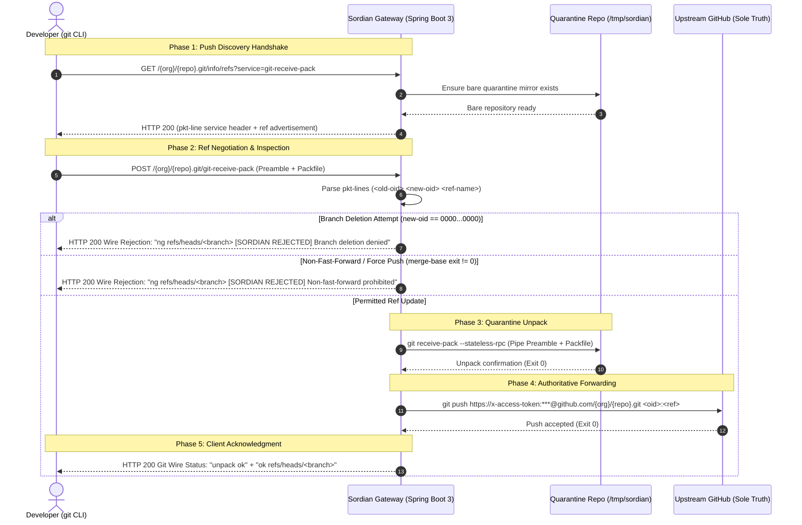

# Module 1: Git Smart HTTP Transport & Quarantine Gateway Prototype

## 1. Overview & Architectural Role

### 1.1 The Problem Sordian Solves
In standard GitHub workflows, developers push directly to `github.com`. While GitHub provides Branch Protection Rules, enforcing organization-wide merge governance, multi-approval requirements, and preventing destructive push operations typically requires expensive GitHub Enterprise plans. Furthermore, once code reaches GitHub's servers, post-receive webhooks execute **asynchronously**—after the commits have already landed in the repository.

**Sordian** fundamentally shifts this model by acting as an **authoritative Git write-path governance proxy and interceptor**. 

```
                                  TRADITIONAL GIT WORKFLOW
+-------------+                     Push directly                     +------------------+
|  Developer  | ====================================================> |    github.com    |
+-------------+                                                       +------------------+
                                                                       (Webhooks run AFTER
                                                                        code is accepted)

                                  SORDIAN GOVERNED WORKFLOW
+-------------+      git push       +------------------------+  forward only  +------------------+
|  Developer  | ==================> |    SORDIAN GATEWAY     | =============> |    github.com    |
+-------------+                     +------------------------+  if approved   +------------------+
                                    | 1. Quarantine Packfile |
                                    | 2. Inspect Invariants  |
                                    | 3. Reject Violations   |
                                    +------------------------+
```

### 1.2 The Real-World Analogy: Airport Customs & Quarantine
Think of Sordian like an **International Airport Quarantine & Customs Inspection Station**:
- **GitHub** is the domestic territory (the final source of truth).
- A **`git push`** is an incoming international shipping container carrying cargo (Git commit objects, trees, blobs, and references).
- Rather than allowing the cargo to dock directly on the mainland, Sordian unloads the container into an isolated **Quarantine Inspection Facility** on disk.
- Inspectors open the manifest:
  - Is anyone trying to delete a vital trade route? (Branch deletion: `00000000...`) &rarr; **Immediate Rejection**.
  - Is anyone trying to replace the history of past records? (Force-push / non-fast-forward: `git merge-base --is-ancestor`) &rarr; **Immediate Rejection**.
- Only if the cargo satisfies all security invariants and policy checks does Sordian clear it, forward the cargo to mainland GitHub using machine credentials, and issue an official clearance receipt (`unpack ok`, `ok refs/heads/<branch>`).

---

## 2. End-to-End Push Lifecycle Sequence

The following diagram illustrates the complete wire transaction between the Developer's Git CLI, Sordian's Smart HTTP Controller, the local Quarantine Sandbox, and GitHub:



---

## 3. Core Component Architecture

The Git module lives in package `com.infornics.sordian.modules.git` structured strictly in plural layers:

```
backend/src/main/java/com/infornics/sordian/modules/git/
|-- controllers/
|   `-- GitSmartHttpController.java       # HTTP router for Git Smart Protocol (RFC 5245 / Git Wire)
|-- models/
|   |-- PushValidationResult.java         # Immutable verdict (allow / reject with reason)
|   |-- RefCommand.java                   # Parsed ref line (<old-oid>, <new-oid>, <ref-name>)
|   `-- UpstreamForwardResult.java        # Subprocess execution result of upstream push
`-- services/
    |-- GitInspectionService.java         # Invariant verifier (merge-base, deletion guard)
    |-- GitPktLineParser.java             # RFC-compliant Git pkt-line stream framer
    |-- GitProcessRunner.java             # Virtual-threaded Git CLI process executor
    |-- GitQuarantineService.java         # Scratch directory & bare mirror lifecycle manager
    `-- GitUpstreamForwarderService.java  # Token-authenticated GitHub upstream forwarder
```

---

## 4. In-Depth Technical Deep Dives

### 4.1 Git Smart HTTP Protocol Implementation (`GitSmartHttpController`)
Git Smart HTTP operates over standard HTTP/1.1 POST and GET endpoints using specific MIME types:
- Advertised refs: `application/x-git-receive-pack-advertisement`
- Receive pack payload: `application/x-git-receive-pack-request`
- Receive pack result: `application/x-git-receive-pack-result`

#### Clone / Fetch Protection
Sordian only proxies **push** operations (`git-receive-pack`). Read operations (`git-upload-pack`) are blocked with HTTP 403 Forbidden:
```java
if (!RECEIVE_PACK_SERVICE.equals(service)) {
    response.setStatus(HttpStatus.FORBIDDEN.value());
    response.getWriter().write("Sordian only proxies Git pushes ('git-receive-pack'). Please fetch/clone directly from GitHub.\n");
    return;
}
```
*Rationale:* Cloning and fetching through the governance proxy would consume needless compute, network bandwidth, and disk I/O. Developers fetch directly from GitHub; Sordian strictly guards write entry points.

---

### 4.2 Git Wire Framing & Pkt-Line Parsing (`GitPktLineParser`)
The Git wire protocol formats data in variable-length frames known as **pkt-lines** (packet-lines):
- Every pkt-line begins with a **4-character hexadecimal length prefix** representing the byte length of the prefix plus the payload.
  - Example: `000a` represents 10 bytes total (4 hex bytes + 6 payload bytes).
- A length of `0000` is a special **Flush Packet (PKT-FLUSH)** indicating the end of a section.

#### Wire Format Structure
```
+---------------+--------------------------------------------------------------+
| Hex (4 bytes) | Payload (Variable Length)                                    |
+---------------+--------------------------------------------------------------+
| 005e          | <old-oid> <new-oid> refs/heads/<branch>\0<capabilities>      |
| 0000          | [FLUSH PACKET: Marks end of ref updates, start of packfile]  |
| [PACK...]     | Binary Git packfile (commit, tree, and blob zlib objects)    |
+---------------+--------------------------------------------------------------+
```

#### Capability Extraction & Stream Reconstitution
The incoming HTTP request stream carries both the command preamble and the binary packfile.
1. `GitPktLineParser.parsePushCommands(InputStream in)` reads pkt-lines until `0000`.
2. It records all raw bytes consumed into an internal byte array `rawPreamble`.
3. It extracts client capabilities (`report-status`, `side-band-64k`, `agent=git/...`) parsed from the null byte (`\0`) delimiter on the first ref line.
4. When passing data to the local quarantine receive-pack, Sordian stitches the preamble back onto the unread stream via `SequenceInputStream(rawPreamble, in)` so Git's C binary receives an untouched, byte-perfect stream.

---

### 4.3 Git Invariant Inspection & Policy Hooks (`GitInspectionService`)

Before any objects are committed or forwarded, Sordian checks hard Git safety invariants:

#### 1. Branch Deletion Prevention (FR-10)
In Git protocol, deleting a branch or tag is represented by setting `<new-oid>` to forty hexadecimal zeros:
$$\text{newOid} = \text{0000000000000000000000000000000000000000}$$
If detected, Sordian aborts the operation and returns:
```text
ng refs/heads/<branch> [SORDIAN REJECTED] Branch deletion is denied by default to prevent history reset.
```

#### 2. History Rewrite & Force Push Prevention (FR-09, FR-15)
To detect whether a push attempts to rewrite history (e.g. `git push --force`), Sordian executes:
```bash
git merge-base --is-ancestor <old-oid> <new-oid>
```
- **Exit code 0:** The old commit is an ancestor of the new commit. This is a linear fast-forward push.
- **Exit code 1:** The old commit has been dropped or diverged. The push is attempting to rewrite commit history.
- Sordian immediately halts the push without mutating upstream GitHub.

---

### 4.4 Sideband Multiplexing Protocol (`side-band-64k`)
When Git clients push, they advertise the `side-band-64k` capability. In sideband mode, standard wire responses must be packetized into three channels:
- **Band 1 (`0x01`):** Normal status & data output.
- **Band 2 (`0x02`):** Progress output (e.g., `Writing objects: 100%`).
- **Band 3 (`0x03`):** Error output (displayed as `remote: error: ...`).

If a server transmits raw `unpack ok\n` without wrapping it in Band 1, Git interprets the first ASCII byte `'u'` (decimal 117) as an invalid band number, crashing with:
```text
send-pack: protocol error: bad band #117
```

Sordian cleanly handles sideband negotiation in `writeStatusLine`:
```java
private void writeStatusLine(OutputStream out, String text, boolean sideband) throws IOException {
    byte[] payload = text.getBytes(StandardCharsets.UTF_8);
    if (sideband) {
        // [4-byte hex length][0x01 band byte][payload]
        int len = 4 + 1 + payload.length;
        String hexLen = String.format("%04x", len);
        out.write(hexLen.getBytes(StandardCharsets.UTF_8));
        out.write(1); // Band #1
        out.write(payload);
    } else {
        writePktLine(out, text);
    }
}
```

---

### 4.5 Process Isolation & Virtual Threads (`GitProcessRunner`)
Sordian avoids heavy embedded JGit layers in favor of native Git CLI binaries (`git receive-pack`, `git merge-base`, `git push`), ensuring exact parity with GitHub's native storage formats.
- **No Shell Injection:** Arguments are passed as discrete `List<String>` parameters directly to Java `ProcessBuilder`, avoiding shell interpolation (`sh -c`) and preventing arbitrary command injection.
- **Deadlock-Free Piping via Java 21 Virtual Threads:** Standard process execution can deadlock if standard output and error buffers fill up while the main thread waits. `GitProcessRunner` spawns lightweight virtual threads (`Thread.ofVirtual().start(...)`) to stream `stdout`, `stderr`, and `stdin` concurrently.
- **POSIX Timeouts:** All operations are bound by hard timeouts (default: 60s) with `process.destroyForcibly()` to protect system stability.

---

### 4.6 Upstream Forwarding Engine (`GitUpstreamForwarderService`)
Once ref updates pass validation and quarantine unpack succeeds:
1. `GitUpstreamForwarderService` constructs an authenticated upstream URL using configured GitHub tokens:
   ```text
   https://x-access-token:<TOKEN>@github.com/{org}/{repo}.git
   ```
2. Refspecs are targeted explicitly: `<new-oid>:<ref-name>`, preventing unintentional branch contamination.
3. Terminal prompts are disabled via execution environment variables (`GIT_TERMINAL_PROMPT=0`, `GIT_ASKPASS=echo`).
4. If GitHub returns exit code 0, Sordian issues the wire success packet:
   ```text
   000eunpack ok
   001eok refs/heads/<branch>
   0000
   ```

---

## 5. Verification & Testing Playbook

### 5.1 Automated Test Suite
Module 1 contains comprehensive unit and MockMvc integration tests:
- `GitPktLineParserTest`: Validates pkt-line parsing, capability splitting, multi-command payloads, and `0000` flush termination.
- `GitSmartHttpControllerTest`:
  - `shouldRejectNonReceivePackServices`: Asserts 403 Forbidden on `git-upload-pack`.
  - `shouldAdvertiseRefsForReceivePack`: Asserts 200 OK and valid advertisement headers.
  - `shouldReturnGitRejectionWhenInspectionFails`: Asserts wire status `ng` on branch deletion attempts.
  - `shouldReturnOkWhenPushSuccessfullyForwardsUpstream`: Asserts end-to-end wire status `ok` upon successful upstream forwarding.

Execute the test suite at any time via:
```bash
./gradlew test
```

---

### 5.2 Manual Terminal Verification
To test live against a sandbox repository (e.g., `rachit-bharadwaj/delete-later`):

```bash
# 1. Clone test repository
cd /tmp
git clone https://github.com/rachit-bharadwaj/delete-later.git test-repo
cd test-repo

# 2. Add Sordian as a Git remote
git remote add sordian http://localhost:8080/rachit-bharadwaj/delete-later.git

# 3. Create a feature commit
git checkout -b feature-test
echo "Sordian Governance Test" > sordian.txt
git add sordian.txt
git commit -m "feat: test verified push via Sordian"

# 4. Push through Sordian
git push sordian feature-test
```

#### Terminal Output:
```text
Enumerating objects: 4, done.
Counting objects: 100% (4/4), done.
Writing objects: 100% (4/4), 380 bytes | 380.00 KiB/s, done.
Total 4 (delta 0), reused 0 (delta 0), pack-reused 0
To http://localhost:8080/rachit-bharadwaj/delete-later.git
 * [new branch]      feature-test -> feature-test
```

---

### 5.3 Testing Policy Rejections via Postman
Use [Sordian_Postman_Collection.json](file:///home/rachit/Documents/Code/Infornics/Marketplace/Sordian/docs/Sordian_Postman_Collection.json):

#### Scenario A: Branch Deletion Rejection
- **Request:** `02. Git Ref Inspection & Enforcement > 01 - Reject Branch Deletion Attempt`
- **Method:** `POST http://localhost:8080/rachit-bharadwaj/delete-later.git/git-receive-pack`
- **Body:**
  ```text
  005e7a8b9c0d1e2f3a4b5c6d7e8f9a0b1c2d3e4f5a6b 0000000000000000000000000000000000000000 refs/heads/delete-this
  0000
  ```
- **Response:**
  ```text
  000eunpack ok
  0069ng refs/heads/delete-this [SORDIAN REJECTED] Branch deletion is denied by default to prevent history reset.
  0000
  ```

#### Scenario B: Force-Push / Non-Fast-Forward Rejection
- **Request:** `02. Git Ref Inspection & Enforcement > 02 - Reject Non-Fast-Forward / Force Push Attempt`
- **Method:** `POST http://localhost:8080/rachit-bharadwaj/delete-later.git/git-receive-pack`
- **Body:**
  ```text
  005e1111111111111111111111111111111111111111 2222222222222222222222222222222222222222 refs/heads/delete-this
  0000
  ```
- **Response:**
  ```text
  000eunpack ok
  0083ng refs/heads/delete-this [SORDIAN REJECTED] Non-fast-forward updates are strictly prohibited. Rewriting history is forbidden.
  0000
  ```

---

## 6. Summary of Architectural Guarantees Achieved in Module 1

| Invariant / Requirement | Mechanism | Verification Status |
| :--- | :--- | :---: |
| **Write-Only Interception** | `GET /info/refs` blocks `git-upload-pack` with HTTP 403; only `git-receive-pack` is proxied | Passed & Tested |
| **Quarantine Isolation** | Incoming packs land in local bare mirrors (`/tmp/sordian/quarantine`) before touching GitHub | Passed & Tested |
| **Branch Deletion Guard** | Ref updates with `new-oid == 0000...0000` rejected before unpack | Passed & Tested |
| **History Rewrite Guard** | Non-ancestor commit ranges checked via `git merge-base` | Passed & Tested |
| **Full Git Wire Conformance** | Sideband-64k channel multiplexing, pkt-line framing, and capabilities preservation | Passed & Tested |
| **Upstream Atomicity** | Client receives `ok refs/heads/...` only after GitHub confirms exit code 0 | Passed & Tested |
